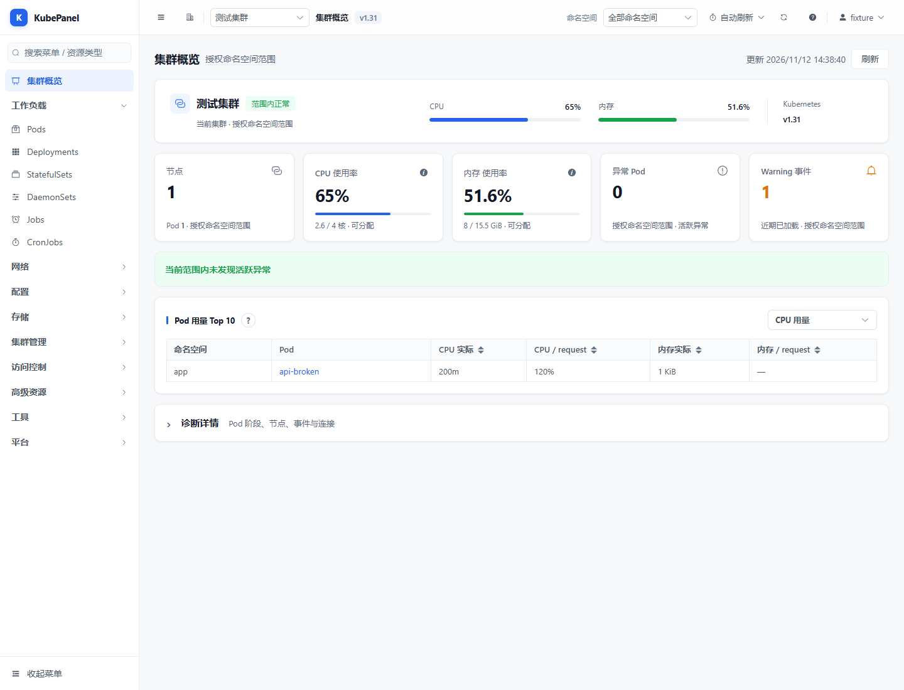

# KubePanel

轻量级 Kubernetes 多集群管理控制台：浏览器里查看集群状态、排查工作负载、编辑资源、执行常用运维操作。前端 Vue 3 + Element Plus，后端 Express，打包为单个非 root Docker 镜像。



## 功能

- **多集群**：导入 kubeconfig、切换集群、连通性检查、证书到期提示。
- **资源管理**：工作负载 / 网络 / 配置 / 存储 / RBAC / 自定义资源的浏览、筛选、分页；完整 / 精简 YAML 查看与编辑、差异对比、服务端预检。
- **日常运维**：Pod 日志与终端、扩缩容、滚动重启与批量重启、发布历史与回滚、CronJob 操作、容器文件浏览与上传下载、节点维护与驱逐。
- **概览与指标**：节点 / Pod 数量、CPU 与内存用量、异常 Pod 与事件统计（依赖集群 Metrics API）。
- **权限与审计**：账号、角色、集群 / 命名空间 / 资源范围授权，敏感操作独立授权与操作记录。
- **外部集成**：Harbor 镜像浏览、Grafana 接入。

## 部署

全新 Linux，以 root 执行（需 Git + Docker，可访问基础镜像与 npm 仓库）：

```bash
git clone https://github.com/7hanks/kubepanel.git && cd kubepanel
REVISION=$(git rev-parse HEAD)
docker build --build-arg BUILD_REVISION="$REVISION" -t "kubepanel:$REVISION" .

install -d -m 700 -o 10001 -g 10001 /opt/kubepanel/data /opt/kubepanel/clusters

docker run -d --name kubepanel --restart unless-stopped \
  -p 9090:8080 \
  -e DASHBOARD_USERNAME=admin \
  -e DASHBOARD_PASSWORD='替换为自己的强密码' \
  -v /opt/kubepanel/data:/app/data \
  -v /opt/kubepanel/clusters:/app/kube/clusters \
  --read-only --tmpfs /tmp:rw,noexec,nosuid,size=64m \
  --cap-drop ALL --security-opt no-new-privileges:true \
  "kubepanel:$REVISION"
```

浏览器打开 `http://服务器IP:9090`，账号 `admin`、密码为启动时指定的值。`DASHBOARD_PASSWORD` 只是**初始密码**，界面改密后以数据目录里的哈希为准；升级须保持管理员用户名一致。容器以 UID/GID `10001` 运行，两个挂载目录必须允许其读写。

登录后到「集群管理」导入 kubeconfig（需含容器内可访问的 API Server 地址与内联证书/密钥或 Token）。面板账号与集群凭据相互独立，实际操作受 kubeconfig 对应的 Kubernetes RBAC 限制。

## 配置

在 `docker run` 中增加 `-e 变量名=值`：

| 变量 | 说明 | 默认 |
| --- | --- | --- |
| `DASHBOARD_USERNAME` | 内置管理员用户名 | `admin` |
| `DASHBOARD_PASSWORD` | 内置管理员初始密码 | 新装必填 |
| `DASHBOARD_SECRET` | 签名 / 加密密钥；显式设置过则升级必须沿用原值 | 自动生成并存于 `/app/data` |
| `DASHBOARD_TOKEN_TTL` | 会话有效期 | `12h` |
| `TZ` | 容器时区 | `Asia/Shanghai` |
| `KUBE_REQUEST_TIMEOUT` | Kubernetes 请求超时（毫秒） | `30000` |
| `TERMINAL_IDLE_MS` / `TERMINAL_MAX_MS` | 终端空闲 / 最长连接时长 | 15 / 60 分钟 |
| `TRUST_PROXY` | 可信反向代理配置 | 不信任代理头 |
| `DASHBOARD_COOKIE_SECURE` | 设为 `true` 时仅通过 HTTPS 发送会话 Cookie | 关 |

改宿主机端口把 `-p 9090:8080` 换成 `-p 你的端口:8080`。IP + 端口直连为明文 HTTP，公网使用应限制访问来源或配置 HTTPS 入口。

## 数据与备份

务必保留两个挂载目录，升级 / 重建时复用原目录：

- `/opt/kubepanel/data`：账号、角色、密码哈希、会话、审计、集成配置、持久化密钥。
- `/opt/kubepanel/clusters`：已导入的 kubeconfig。

```bash
bash deploy/backup.sh   # 默认备份到 /opt/kubepanel-backups/，含敏感凭据，私密保存
```

存储为持久化 JSON，按单实例运行，不能多容器共写同一数据目录。不要通过删除数据目录来重置密码，也不要只备份账号文件而遗漏密钥。

## 健康检查与排障

```bash
docker ps --filter name=kubepanel
docker logs --tail 100 kubepanel
curl --fail http://127.0.0.1:9090/livez    # 进程存活
curl --fail http://127.0.0.1:9090/readyz   # 应用就绪
```

- **无法登录**：核对用户名；数据目录里曾改过密码就用改后的密码。
- **集群连接失败**：检查 API Server 网络可达性、CA、凭据有效期与 RBAC；容器内 `127.0.0.1` 指向容器自身。
- **没有 CPU / 内存指标**：检查集群 Metrics API 是否可用。

`/healthz` 为兼容入口。探针成功不代表每个集群都连通，集群状态需登录查看。

## 本地开发

需要 Node.js 22+：

```bash
npm --prefix server ci && npm --prefix frontend ci
DASHBOARD_PASSWORD='dev密码' npm --prefix server start   # 终端一
npm --prefix frontend run dev                            # 终端二
```

验证：

```bash
npm --prefix server run check && npm --prefix server test
npm --prefix frontend test && npm --prefix frontend run build
```

发布与回滚参见 `deploy/release.sh`、`deploy/backup.sh`、`deploy/verify.sh`。
