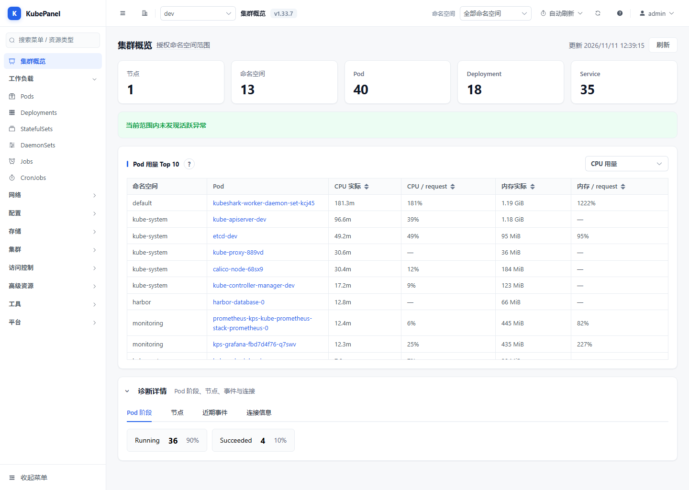

# KubePanel

轻量多集群 Kubernetes 运维控制台，Vue 3 / Element Plus 前端与 Express 后端打包为单个非 root Docker 镜像。持久化 JSON 数据采用单副本部署。



## 功能与边界

- 多集群导入、切换、连通性检查，API Discovery 驱动内置资源和 CRD 浏览。
- 资源查询、YAML 编辑、Apply 预检与逐项结果、扩缩容、滚动重启、日志和终端。
- 账号、角色、敏感操作权限及 cluster / namespace / resource 范围，服务端执行授权。
- 发布历史与回滚、节点维护、CronJob 操作和操作审计；具体授权与前提见界面提示。
- Harbor 镜像浏览与分页、Grafana 配置和内置指标。集成 TLS 默认校验证书，可配置私有 CA。

认证、集群凭据和范围授权共同决定操作权限。不要把平台登录权限等同于集群授权；给 kubeconfig / ServiceAccount 发放所需的最小权限。

## 新安装

需要 Docker Compose、Node.js 22（本地开发），以及可用 kubeconfig 或集群内 ServiceAccount。生产部署脚本另需 Linux Bash、Python 3、curl、flock。

```bash
cp .env.example /opt/kubepanel/.env
chmod 600 /opt/kubepanel/.env
# 私下编辑，填写强初始密码；不要在命令或日志输出密码。
install -d -m 700 -o 10001 -g 10001 /opt/kubepanel/data /opt/kubepanel/clusters
docker compose --env-file /opt/kubepanel/.env up -d --build
```

默认使用 `http://服务器IP:9090`，保留现有 IP+端口访问方式。账号默认 `admin`。新安装应显式设置 `DASHBOARD_PASSWORD`；密码不输出到日志。已有用户、密码与角色从数据卷继续加载。

**当前 HTTP 会明文传输登录、会话及业务数据。** 在尚无域名的部署中限制防火墙来源；后续可使用受信任的 HTTPS 入口。`BIND_ADDRESS` 默认 `0.0.0.0`，配置本机 HTTPS 代理后可改为 `127.0.0.1`。仅在明确可信代理时配置 `TRUST_PROXY`。

生产升级使用 [部署与发布流程](docs/deployment.md)；不要通过重建 development 标签覆盖生产版本。

## 运行数据

- `/opt/kubepanel/data` → `/app/data`：账号、角色、会话、审计和集成配置，以及持久化密钥。
- `/opt/kubepanel/clusters` → `/app/kube/clusters`：集群 kubeconfig。
- 两个目录保持可写、属主 UID/GID 10001，并独立于源码目录备份。不得加入 Git、源码包或 Docker 构建上下文。
- Harbor 密码和 Grafana Token 在写入时加密；旧明文配置可读，后续写入时升级。恢复时必须保留配套密钥（`data/.jwt-secret` 或显式配置的 `DASHBOARD_SECRET`），不能只复制密文。

JSON 文件损坏或无法读取会报错并拒绝覆盖；先保留原文件，再从私有备份恢复。不要用删除数据目录的方式排障。

## 配置

完整示例在 [.env.example](.env.example)。主要变量：`DASHBOARD_USERNAME`、`DASHBOARD_PASSWORD`、`DASHBOARD_SECRET`、`DASHBOARD_TOKEN_TTL`、`DATA_DIR`、`KUBE_CLUSTERS_DIR`、`KUBECONFIG` / `KUBE_CONFIG_B64`、`HOST` / `PORT`。发布镜像嵌入 `BUILD_REVISION` 和 `SOURCE_MANIFEST_SHA256`。

`/livez` 是进程存活检查；`/readyz` 是应用就绪检查；`/healthz` 为兼容别名。公共响应仅含最小状态与版本信息，集群异常不会触发无意义的进程重启。详细状态需认证后查看。

集群内部署参考 [deployment.yaml](deploy/deployment.yaml) 和 [rbac.yaml](deploy/rbac.yaml)：先创建私有认证 Secret，替换不可变镜像版本；模板采用单副本 Recreate，并为数据与集群配置分别挂 PVC。

## 开发与验证

```bash
npm --prefix server ci
npm --prefix frontend ci
npm --prefix server run check
npm --prefix server test
npm --prefix frontend test
npm --prefix frontend run build
python3 deploy/test_manifest.py
bash -n deploy/backup.sh deploy/release.sh deploy/verify.sh deploy/smoke-test.sh
```

开发：`npm --prefix server start` 与 `npm --prefix frontend run dev`。开发数据也应使用独立目录。

`deploy/verify.sh` 为不写业务资源的发布版本检查；旧 `deploy/smoke-test.sh` 会创建 / 删除 ConfigMap 并导入 / 删除测试集群，**不是只读检查，不应直接对生产运行**。

架构边界见 [architecture.md](docs/architecture.md)。前端资源路径通过 `cpath()` 保留 clusterId；后端 API 必须同时执行平台权限与资源范围校验。
