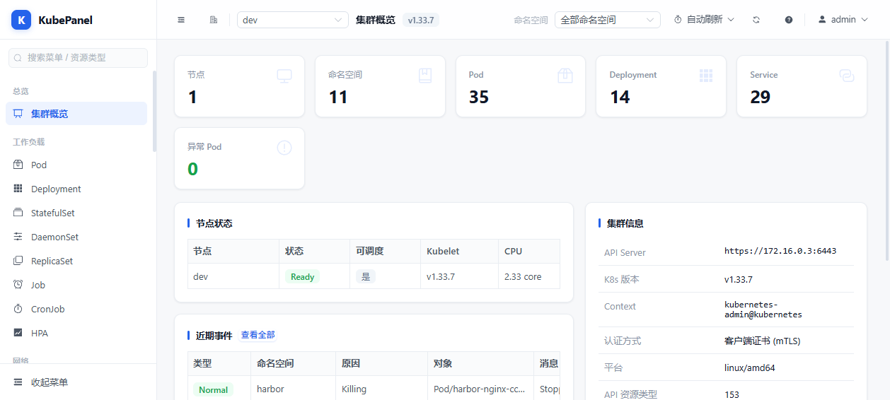
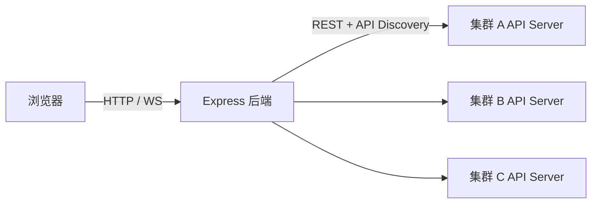

# KubePanel

> 轻量级多集群 Kubernetes 可视化控制台 —— 用浏览器完成原本需要 `kubectl` 的操作。



KubePanel 把 Vue 3 前端与 Node.js/Express 后端打进**一个 Docker 镜像**，无需数据库、无需 Nginx。登录后先看到集群列表，进入某个集群再浏览和操作资源；每个集群持有独立 kubeconfig，资源通过 API Discovery 动态发现，内置资源与 CRD 用同一套通用表格呈现。

## 功能

- **多集群**：集群列表查看状态 / 版本 / 节点数，界面导入、切换、测试连接、移除；每个集群独立凭据与资源发现缓存。
- **通用资源浏览**：Pod、Deployment、Service、ConfigMap、Secret、Node、PV、StorageClass、Namespace、Event 及任意 CRD 实例，无需为每种资源写 CRUD。
- **常用操作**：YAML 只读预览与编辑、模板新建、扩缩容、滚动重启、Pod 日志（SSE 实时跟随）、Web 终端（xterm.js + WebSocket）、删除二次确认。
- **集群概览**：统计卡、节点状态、近期事件、Pod 状态分布下钻、资源使用率（依赖 metrics-server）。
- **用户与角色**：「对象 × 动作」可配置权限矩阵，角色可自建 / 改 / 删，越权请求服务端拦截返回 403。
- **扩展**：镜像仓库（Harbor）浏览、监控（Grafana 嵌入或内置指标）。
- **界面**：浅色低饱和设计，可折叠侧栏、命名空间切换、顶栏自动刷新。

## 架构



两级信息架构：`/clusters`（平台级集群列表）→ `/c/:clusterId/...`（单集群资源控制台）。认证分两层：**JWT** 决定能否进页面，**kubeconfig / ServiceAccount** 决定能操作什么。

| 层 | 选型 |
|---|---|
| 前端 | Vue 3 + Element Plus + Vite + xterm.js |
| 后端 | Node.js 22 ESM + Express 5 + `@kubernetes/client-node` |
| 实时通道 | SSE（日志）+ WebSocket（终端） |
| 交付 | Docker 多阶段构建单镜像，非 root（UID 10001）运行 |

关键代码位置：`server/src/`（clusterService / kube / actions / auth / routes / logs / terminal）、`frontend/src/`（views / config / utils/path.js）、`deploy/`（rbac.yaml、deployment.yaml、smoke-test.sh）。

## 快速开始

**前提**：Docker 20.10+、Kubernetes v1.24+、一个可读写的 kubeconfig。

### Docker Compose（推荐）

```bash
git clone https://github.com/7hanks/kubepanel.git
cd kubepanel
cp .env.example .env
# 编辑 .env，设置 DASHBOARD_PASSWORD（≥12 位）

mkdir -p /opt/kubepanel/clusters /opt/kubepanel/data
chown -R 10001:10001 /opt/kubepanel/clusters /opt/kubepanel/data

docker compose up -d --build
```

打开 `http://localhost:9090`，默认用户 `admin`，密码为 `.env` 中的 `DASHBOARD_PASSWORD`（留空则启动时随机生成并打印在 `docker logs`）。

### 仅用 docker run

```bash
docker build -t kubepanel:1.4.0 .
docker run -d --name kubepanel --restart unless-stopped \
  -p 9090:8080 --env-file .env -e DATA_DIR=/app/data \
  -v /opt/kubepanel/clusters:/app/kube/clusters \
  -v /opt/kubepanel/data:/app/data \
  kubepanel:1.4.0
```

> 两个卷必须**可写**（不要加 `:ro`），属主 `10001`：前者存 kubeconfig，后者存账号 / 角色 / 仓库 / 监控配置。少挂任一个，重建容器就会丢集群或丢改过的密码。

健康检查：`curl -s http://localhost:9090/healthz`（返回各集群连通状态，无需认证）。完整冒烟脚本见 `deploy/smoke-test.sh`。

## 纳管集群

| 方式 | 操作 | 适用 |
|---|---|---|
| 放文件（推荐） | kubeconfig 复制为 `/opt/kubepanel/clusters/*.yaml`，页面刷新 | 批量纳管 / 自动化 |
| 界面导入 | 集群列表 →「导入集群」→ 名称 + kubeconfig | 临时添加，不登服务器 |
| 环境变量 | `KUBE_CONFIG_B64=<base64>` 或 `KUBECONFIG=/path` | CI / 单集群体验 |
| 集群内部署 | ServiceAccount 自动注册为「当前集群」 | 见 `deploy/rbac.yaml` |

一个 kubeconfig 含多个 context 时，每个 context 各注册为一个集群。

## 配置项

通过环境变量或 `.env`（已 gitignore）设置，完整列表见 `server/src/config.js`。

| 变量 | 默认值 | 说明 |
|---|---|---|
| `DASHBOARD_USERNAME` | `admin` | 登录用户名 |
| `DASHBOARD_PASSWORD` | 随机生成 | 未设置时自动生成并打印在启动日志 |
| `DASHBOARD_SECRET` | 自动生成并落盘 | JWT 签名密钥；不填则写入 `DATA_DIR/.jwt-secret` 并复用，仅多副本共享会话时需显式指定 |
| `DASHBOARD_TOKEN_TTL` | `12h` | 登录有效期 |
| `DASHBOARD_AUTH_ENABLED` | `true` | 设 `false` 关闭登录（仅本地调试） |
| `KUBE_CLUSTERS_DIR` | `/app/kube/clusters` | **可写**集群凭据目录 |
| `DATA_DIR` | `/app/data` | **可写**数据目录（密码哈希、角色、仓库、监控配置） |
| `PORT` | `8080` | 容器内监听端口 |
| `KUBE_CONFIG_B64` / `KUBECONFIG` | 空 | 额外注入 kubeconfig |

集群加载顺序：目录扫描 → `KUBECONFIG` → `KUBE_CONFIG_B64` → in-cluster ServiceAccount → 本机默认 kubeconfig。

## 本地开发

```bash
cd server   && npm install && npm run check && DASHBOARD_PASSWORD=dev123 node index.js
cd frontend && npm install && npm run dev      # vite 已把 /api 代理到 8080
cd frontend && npm run build                  # 构建验证
```

加资源菜单改 `frontend/src/config/resources.js`，加接口改 `server/src/routes.js` + `frontend/src/api/index.js`；集群内跳转统一走 `frontend/src/utils/path.js` 的 `cpath()`，否则 URL 会丢 `clusterId`。

## 安全须知

- **登录账号 + admin kubeconfig = 集群 admin 权限**：任何能打开页面的人都能操作所有纳管集群（含 Web 终端）。务必改默认密码、限制来源 IP、按最小权限发放 kubeconfig，生产前置 HTTPS 反代，**不要把 9090 直接暴露公网**。
- 密码、JWT 密钥、Token 只放 `.env` 或数据卷（git 已忽略），不要提交或贴进 issue / 聊天记录。
- 列表里的「YAML」是**只读预览**，改资源点「编辑」或「更多 → 编辑 YAML」；「重启 Pod」本质是删除后由控制器重建，**裸 Pod 会被拒绝**，生产可先用 `?dryRun=1` 预检。

## 常见问题

- **导入集群报「目录只读」**：目录属主不是 10001 或挂了 `:ro`，按上面 `chown` 处理。
- **exec 插件型 kubeconfig 认证失败**：容器内没有 aws / gcp / oidc CLI，改用内嵌证书 / Token 型 kubeconfig 或 ServiceAccount；相对路径证书用 `kubectl config view --raw --flatten` 展平。
- **CPU / 内存显示配额而非实时用量**：集群未安装 metrics-server。
- **改了源码没生效**：前端改动同样要重建镜像（`frontend/dist` 是构建阶段产物），不要 `docker exec` 进容器改代码。
- **日志流不实时 / Web 终端连不上**：反代需 `proxy_buffering off;` 并允许 WebSocket 升级；终端还需要 `pods/exec` 的 `create` 权限。
